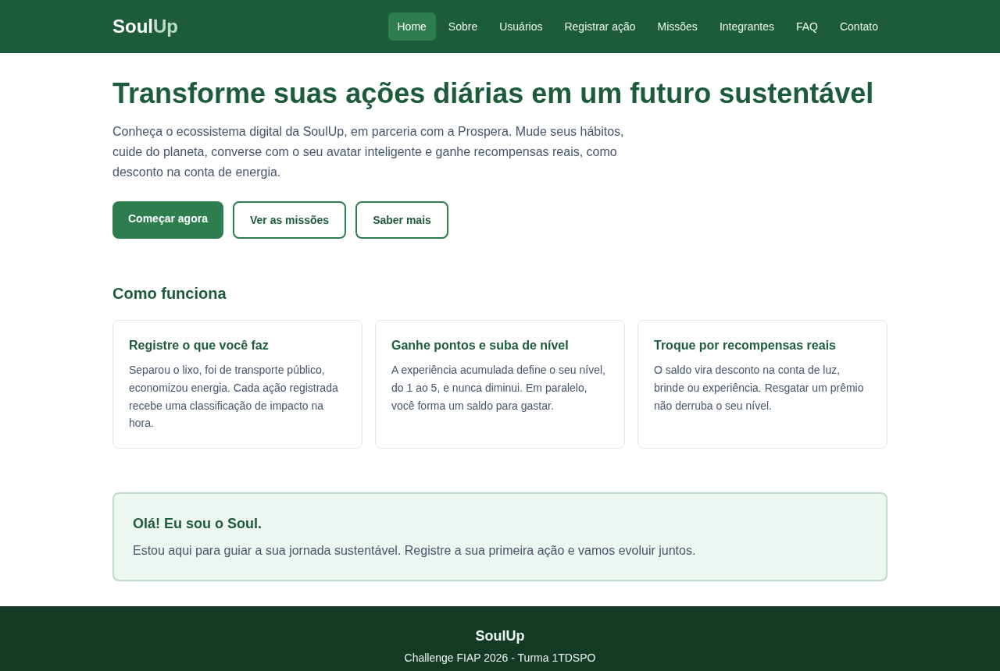
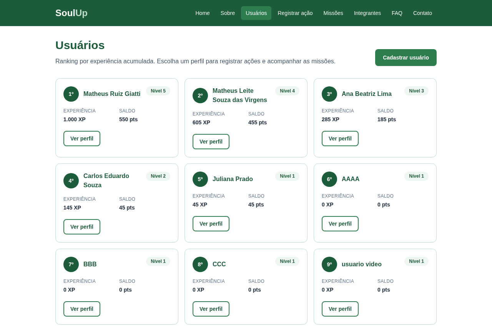
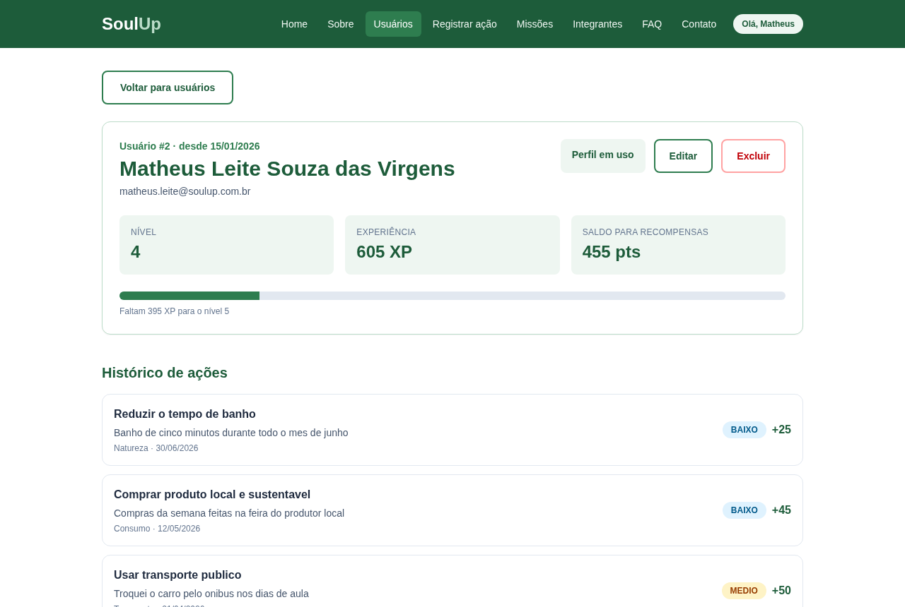
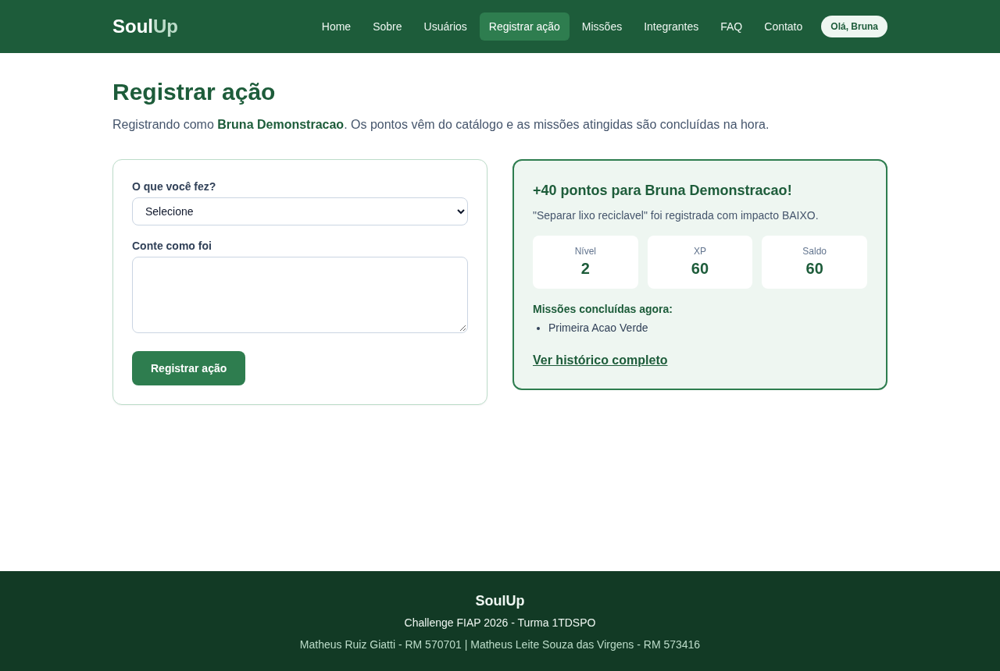
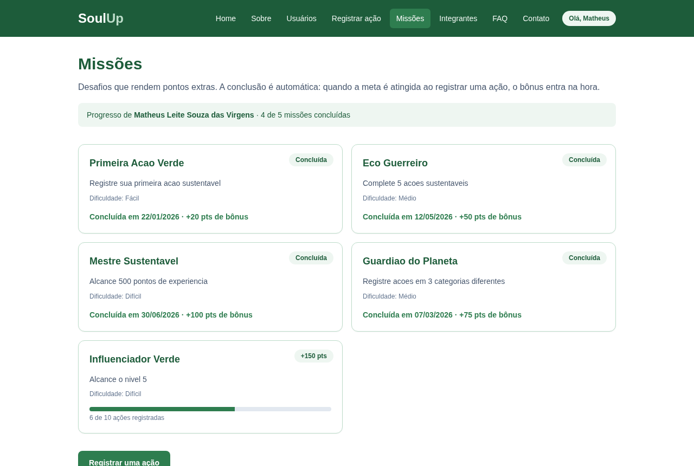
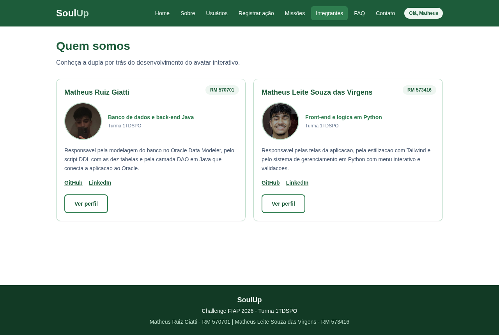
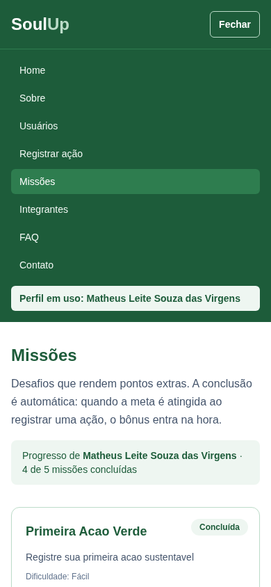
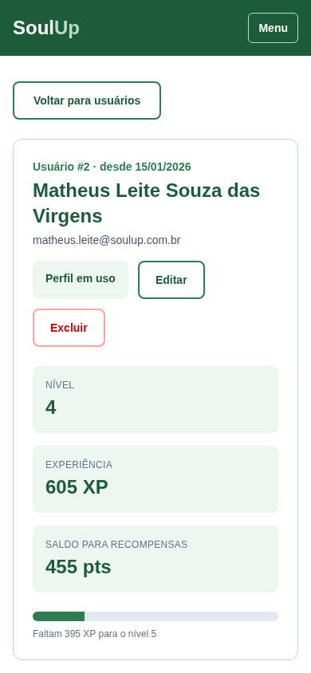

# SoulUp — Avatar Inteligente e Interativo

Aplicação web do **SoulUp**, plataforma que transforma ações sustentáveis do dia a dia
em pontos, níveis e recompensas reais, acompanhada por um avatar chamado Soul.

O usuário registra o que fez — separou o lixo, foi de transporte público, economizou
energia — e cada ação vira experiência e saldo. A experiência faz ele subir de nível;
o saldo é trocado por desconto na conta de luz, brindes e experiências. Missões dão
pontos extras e são concluídas automaticamente quando a meta é atingida.

Projeto do Challenge FIAP 2026, em parceria com SoulUp e Prospera. Esta é a entrega da
**Sprint 4**: a SPA em React consome a API RESTful em Java (Spring Boot) publicada no
Render, que grava os dados no banco Oracle.

---

## Como usar

### Links do projeto

- **Aplicação publicada (Vercel):** <https://challenge-1tdspo.vercel.app>
- **Repositório no GitHub:** <https://github.com/matheusruiz-07/Challenge-1TDSPO>
- **Vídeo de apresentação (YouTube):** LINK_YOUTUBE
- **API Java publicada (Render):** <https://soulup-api-k9nq.onrender.com>
- **Documentação da API (Swagger):** <https://soulup-api-k9nq.onrender.com/swagger-ui.html>

> A API usa o plano gratuito do Render, que "dorme" quando fica sem uso. O primeiro
> acesso pode levar cerca de um minuto; nesse tempo a tela mostra a mensagem de
> carregamento.

### Usando a aplicação

1. Em **Usuários**, veja o ranking e cadastre um usuário ou abra um perfil existente.
2. No perfil, clique em **Usar este perfil**. O nome aparece no menu e fica salvo no
   navegador.
3. Em **Registrar ação**, escolha a ação do catálogo e descreva o que fez. A tela
   mostra os pontos ganhos, o novo nível e as missões concluídas.
4. Em **Missões**, acompanhe o progresso de cada desafio.
5. No perfil também é possível **editar** nome e e-mail e **excluir** o usuário.

### Rodando na sua máquina

Precisa do **Node 20.19 ou mais novo** (recomendado: Node 24 LTS).

```bash
git clone https://github.com/matheusruiz-07/Challenge-1TDSPO
cd Challenge-1TDSPO
npm install
```

Crie o arquivo `.env` a partir do modelo e informe o endereço da API:

```bash
cp .env.example .env
# VITE_API_URL=https://soulup-api-k9nq.onrender.com
```

```bash
npm run dev       # servidor local em http://localhost:5173
npm run lint      # análise estática com oxlint
npm run build     # verificação TypeScript e versão de produção em dist/
npm run preview   # serve a versão de produção localmente
```

---

## Tecnologias utilizadas

| Tecnologia | Para quê |
|---|---|
| **React 19** | interface em componentes, hooks `useState`, `useEffect` e `useContext` |
| **Vite 8** | servidor de desenvolvimento e build |
| **TypeScript 7** | tipagem estática, com interfaces, union e intersection types |
| **Tailwind CSS 4** | toda a estilização e a responsividade, sem CSS próprio |
| **React Router 8** | navegação SPA com rotas estáticas, dinâmicas e redirecionamentos |
| **React Hook Form 7** | formulários de usuário, de registro de ação e de contato |
| **Fetch API** | requisições HTTP à API Java (sem bibliotecas externas) |
| **oxlint** | análise estática do código (`npm run lint`) |
| **Git, GitHub e Vercel** | versionamento com gitflow e publicação da aplicação |
| **API Java (Spring Boot)** | back-end RESTful publicado no Render, com banco Oracle |

---

## Estrutura de pastas

```
Challenge-1TDSPO/
├── index.html                 entrada do Vite
├── package.json               dependências e scripts
├── vite.config.ts             plugins do React e do Tailwind
├── vercel.json                faz todas as rotas da SPA abrirem o index.html
├── .env.example               modelo da variável VITE_API_URL
├── public/                    favicon
├── docs/                      capturas de tela usadas neste README
└── src/
    ├── main.tsx               rotas (createBrowserRouter) e RouterProvider
    ├── App.tsx                estrutura comum: Header, Outlet e Footer
    ├── index.css              Tailwind e a paleta de cores do SoulUp
    ├── env.d.ts               tipo da variável de ambiente
    ├── assets/integrantes/    fotos dos integrantes
    ├── components/            peças reutilizáveis
    │   ├── Header.tsx         menu responsivo e perfil em uso
    │   ├── Footer.tsx
    │   ├── Botao.tsx, Card.tsx
    │   ├── FormularioUsuario.tsx            cadastro e edição
    │   └── Carregando.tsx, MensagemErro.tsx, ListaVazia.tsx
    ├── contexts/              usuário em uso (Context API + localStorage)
    ├── services/              chamadas à API com fetch
    │   ├── api.ts             função base: URL, response.ok e erros
    │   └── usuarios.ts, acoes.ts, missoes.ts
    ├── types/                 contratos TypeScript (usuário, ação, missão, API)
    ├── data/                  conteúdo fixo: integrantes e FAQ
    └── pages/                 uma por rota
```

### Rotas

| Caminho | Página | API |
|---|---|---|
| `/` | Home | — |
| `/sobre` | Sobre o projeto | — |
| `/usuarios` | Ranking de usuários | `GET /usuarios` |
| `/usuarios/novo` | Cadastro de usuário | `POST /usuarios` |
| `/usuarios/:id` | Perfil e histórico — **rota dinâmica** | `GET /usuarios/{id}`, `GET /usuarios/{id}/registros`, `DELETE /usuarios/{id}` |
| `/usuarios/:id/editar` | Edição do usuário — **rota dinâmica** | `PUT /usuarios/{id}` |
| `/registrar` | Registrar ação sustentável | `GET /acoes`, `POST /registros` |
| `/missoes` | Missões e progresso | `GET /missoes`, `GET /usuarios/{id}/missoes` |
| `/integrantes` | Equipe | — |
| `/integrantes/:rm` | Perfil de um integrante — **rota dinâmica** | — |
| `/faq` | Perguntas frequentes | — |
| `/contato` | Formulário de contato | — |
| `/solucao`, `/meu-avatar` | Endereços antigos, redirecionados para `/missoes` | — |
| qualquer outro | Página de erro 404 | — |

---

## Imagens do projeto

| Home | Usuários |
|---|---|
|  |  |

| Perfil | Registrar ação |
|---|---|
|  |  |

| Missões | Integrantes |
|---|---|
|  |  |

| Celular: menu | Celular: perfil |
|---|---|
|  |  |

---

## Autores e créditos

<table>
  <tr>
    <td align="center" width="50%">
      <br>
      <b>Matheus Ruiz Giatti</b><br>
      RM 570701 &middot; Turma 1TDSPO<br><br>
      Banco de dados e back-end Java<br><br>
      <a href="https://github.com/matheusruiz-07">GitHub</a> &middot;
      <a href="https://www.linkedin.com/in/matheus-ruiz-giatti/">LinkedIn</a>
    </td>
    <td align="center" width="50%">
      <br>
      <b>Matheus Leite Souza das Virgens</b><br>
      RM 573416 &middot; Turma 1TDSPO<br><br>
      Front-end e lógica em Python<br><br>
      <a href="https://github.com/matheusleite21">GitHub</a> &middot;
      <a href="https://www.linkedin.com/in/matheus-leite-aaab75352/">LinkedIn</a>
    </td>
  </tr>
</table>

Equipe **SoulUp** · Challenge FIAP 2026 · Turma 1TDSPO

---

## Contato

Dúvidas sobre o projeto podem ser enviadas pelo LinkedIn de qualquer um dos dois
integrantes, ou pela página de contato da própria aplicação, em `/contato`.

Para questões sobre o código, abra uma
[issue no repositório](https://github.com/matheusruiz-07/Challenge-1TDSPO/issues).

---

## Como o projeto está organizado no Git

O repositório segue o gitflow:

- **`main`** — o que está pronto para entrega
- **`develop`** — integração do trabalho em andamento
- **`feature/...`** — uma branch por tarefa, com pull request para a `develop`
